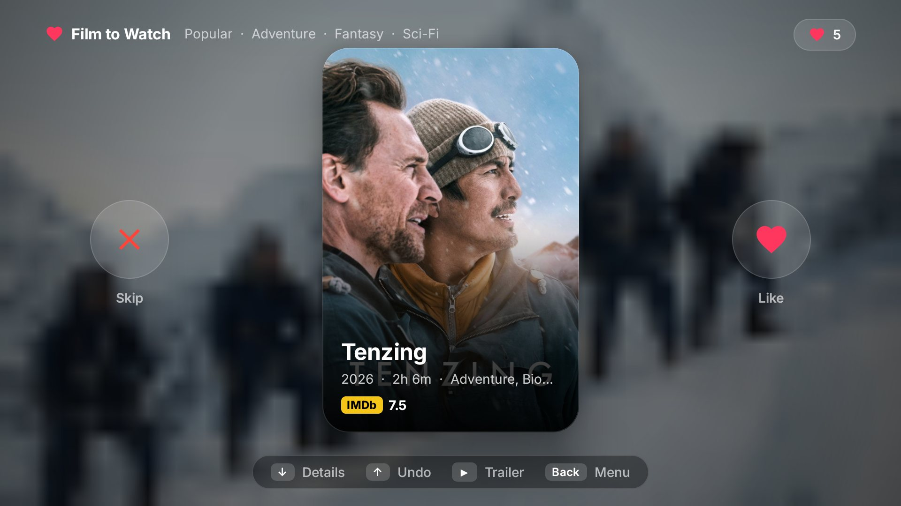
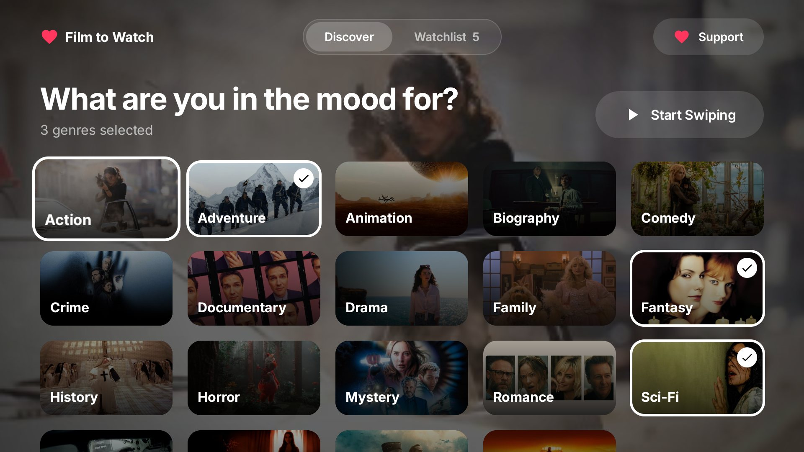
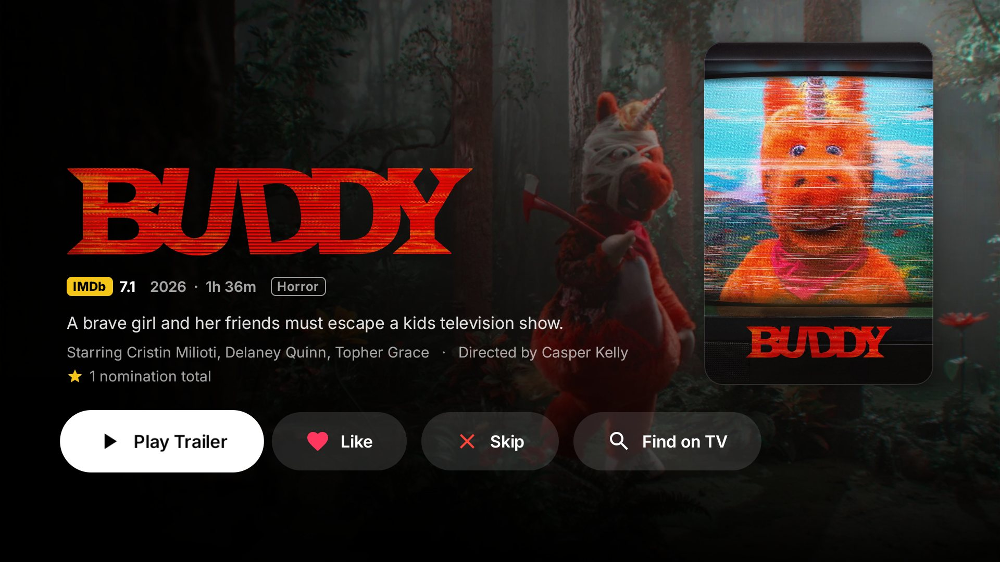
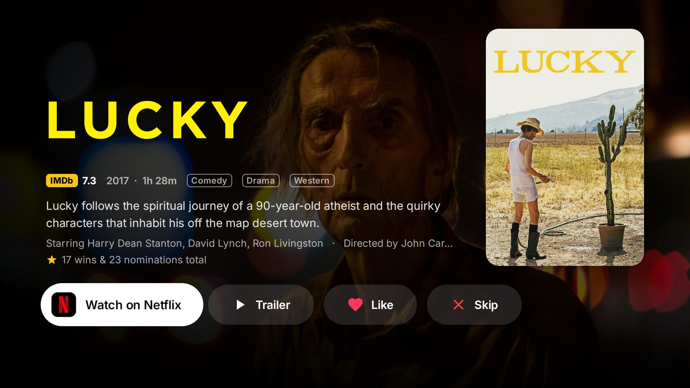
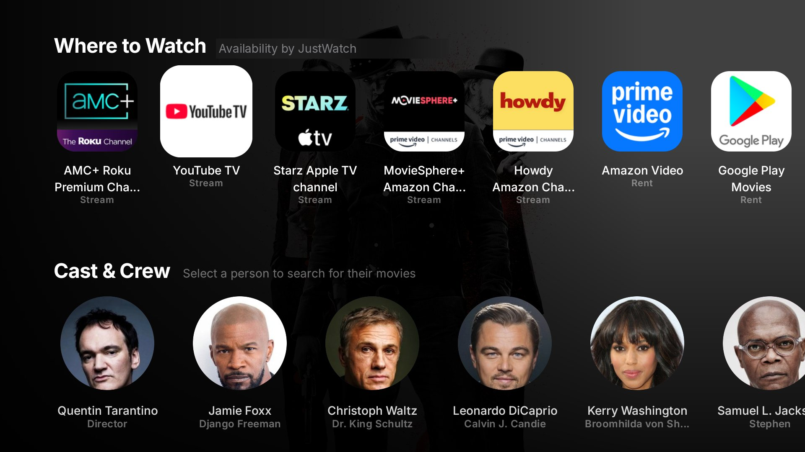
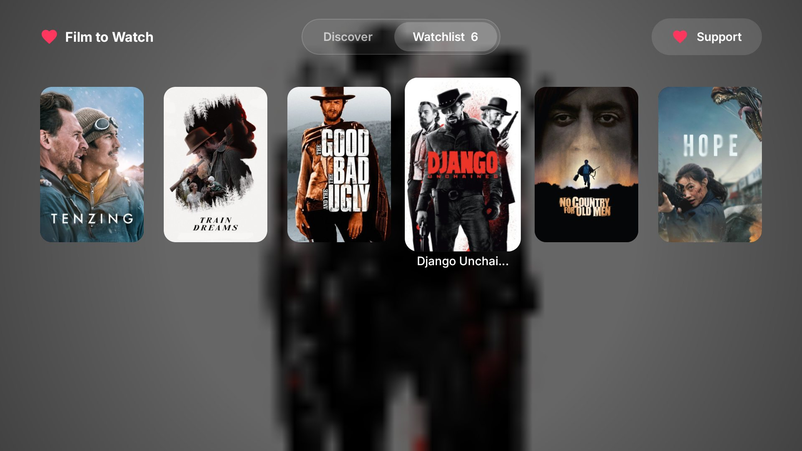
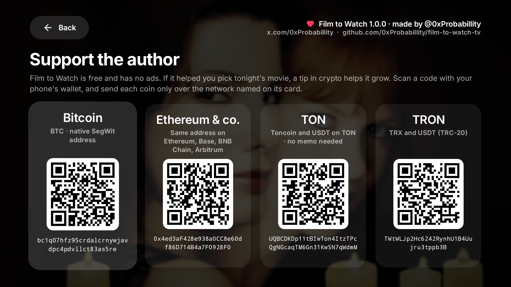

<p align="center">
  
</p>

<h1 align="center">Film to Watch</h1>

<p align="center">
  Tinder for movies, on your Android TV. Pick a few genres, swipe through posters with the remote,<br>
  and end up with a watchlist and a <b>Watch on Netflix</b> button instead of another hour of scrolling.
</p>

<p align="center">
  <a href="#install"><b>Install</b></a> &nbsp;·&nbsp;
  <a href="#let-an-ai-agent-install-it"><b>Let an AI agent install it</b></a> &nbsp;·&nbsp;
  <a href="#add-your-own-tmdb-key"><b>Add your own TMDB key</b></a> &nbsp;·&nbsp;
  <a href="#support-the-project"><b>Support the project</b></a>
</p>

<p align="center">
  Made by <a href="https://x.com/0xProbabillity">@0xProbabillity</a>
</p>

## What it does

- **Swipe, don't scroll.** `→` likes a movie, `←` skips it, `↓` opens the details, `↑` undoes the last swipe. Cards
  fly off with a tilt, the next one is already loaded.
- **Pick the mood first.** Choose one or more genres (or none for everything) and the order: *Popular*, *Top Rated* or
  *New Releases*. Movies you've already swiped never come back.
- **Everything you need to decide.** Poster, title, year, runtime, genres and IMDb rating on the card; on the details
  page the title logo over the backdrop, the full poster, the plot, awards, cast & crew with photos and the English
  trailer (opens in YouTube).
- **Straight to the movie.** With a free TMDB key, the details page shows where to stream, rent or buy it in your
  country, and a **Watch on Netflix** (Prime Video, Disney+, Max, …) button that opens the right app.
- **Your watchlist.** Every movie you liked, as a poster wall. Stored on the TV, no account.
- **Works without any keys.** Out of the box it uses free public data. Keys only add extras.
- **Made for the sofa.** A dark, tvOS-inspired interface: big type, frosted glass, focus that lifts what you select.

<p align="center">
  
  
  
  
  
  
</p>

## Requirements

| | You need |
| --- | --- |
| TV | Android TV or Google TV, Android 8.0 or newer (Xiaomi TV Stick, Chromecast with Google TV, Sony, TCL, Philips, …) |
| Computer | macOS, Linux or Windows on the same Wi-Fi, with [ADB](https://developer.android.com/tools/releases/platform-tools) |
| To build it yourself | JDK 17 and the Android SDK (only needed for your own TMDB key, see below) |

## Install

**1. Turn on developer mode on the TV** (once, with the remote):

- *Settings → Device Preferences → About* (Google TV: *Settings → System → About*), select **Build** 7 times until it
  says you're a developer.
- *Settings → Device Preferences → Developer options* (Google TV: *Settings → System → Developer options*): turn on
  **USB debugging**, and **Network debugging** / **ADB debugging over network** if your TV lists it.
- Note the TV's IP address: *Settings → Network & Internet →* your Wi-Fi network.

> [!NOTE]
> This lets a computer on your Wi-Fi install apps on the TV, press remote buttons and take screenshots. That's what
> makes the AI-agent setup below possible. You approve each computer once on the TV, and you can turn developer mode
> off again at any time.

**2. Install ADB on your computer:**

```bash
brew install --cask android-platform-tools   # macOS
sudo apt install adb                          # Debian / Ubuntu
winget install Google.PlatformTools           # Windows
```

**3. Connect and install** the APK from [Releases](../../releases/latest):

```bash
adb connect 192.168.1.50:5555        # your TV's address; accept "Allow USB debugging?" on the TV
adb install -r film-to-watch-tv-1.0.0.apk
adb shell am start -n com.filmtowatch.tv/.MainActivity
```

*Film to Watch* now sits in the apps row of the TV's home screen. That's all: the release works without any keys.

## Let an AI agent install it

Give [Claude Code](https://claude.com/claude-code), Codex or any coding agent with a terminal this prompt:

```text
Install the Film to Watch app on my TV: https://github.com/0xProbabillity/film-to-watch-tv
Follow INSTALL.md in that repository. Do everything you can yourself, and walk me through
the steps that need my TV remote or my browser one at a time.
```

[`INSTALL.md`](INSTALL.md) is written for agents: it checks the tools, connects to the TV, installs the release, and
can set up your own TMDB key and build. It also tells the agent which steps only you can do (pressing buttons on the
TV, creating the TMDB account) and how to verify each step with screenshots from the TV.

## Add your own TMDB key

Without a key you get movies, ratings, trailers, cast photos and *Find on TV*. A free
[TMDB](https://www.themoviedb.org) key adds:

- **Where to Watch** for your country (streaming, free, rent, buy), with a **Watch on …** button first in the row
- the **full cast** with character names and TMDB photos
- **reviews**, readable in full on the TV
- a **streaming region** picker on the Discover tab (United States and 30 European countries)

Keys are compiled into the app, so this means building it yourself:

1. **Get the key.** Sign up at [themoviedb.org](https://www.themoviedb.org/signup) and confirm your email. Open
   [Settings → API](https://www.themoviedb.org/settings/api), choose **Create → Personal / non-commercial**, accept
   the terms and fill in the form. A summary that works:

   > Personal, non-commercial Android TV app I use at home to decide what to watch. It shows movie posters, details,
   > cast, trailers, reviews and where a movie is available to stream in my country (watch providers), and keeps a
   > local watchlist. Read-only public data, low request volume, TMDB and JustWatch are credited in the app. Not
   > sold, monetized or published on any store.

   Copy the **API Read Access Token** (the long one starting with `eyJ`). The shorter *API Key* works too.

2. **Put it into `local.properties`** (git-ignored, never commit it):

   ```bash
   cp local.properties.example local.properties
   # then edit: sdk.dir=…  and  TMDB_API_KEY=eyJ…
   ```

   Optional: `OMDB_API_KEY=` from [omdbapi.com](https://www.omdbapi.com/apikey.aspx) adds Rotten Tomatoes and
   Metacritic scores.

3. **Build and install:**

   ```bash
   scripts/build.sh                  # needs JDK 17 and the Android SDK
   scripts/install.sh 192.168.1.50   # your TV's address
   ```

> [!IMPORTANT]
> An APK built with your key contains that key. Keep it to yourself. The APK in Releases is built without keys
> (`NO_KEYS=1`), and switching between it and your own build means uninstalling first, which clears the watchlist.

## Build from source

```bash
git clone https://github.com/0xProbabillity/film-to-watch-tv.git && cd film-to-watch-tv
scripts/build.sh            # debug build -> app/build/outputs/apk/debug/app-debug.apk
scripts/build.sh release    # minified release -> dist/film-to-watch-tv-<version>.apk
```

- JDK 17: `brew install openjdk@17` (the script finds Homebrew's and the usual Linux paths), or set `JAVA_HOME`.
- Android SDK: Android Studio, or `brew install --cask android-commandlinetools` and
  `sdkmanager "platforms;android-35" "build-tools;34.0.0" "platform-tools"`. Point `sdk.dir` in `local.properties` to it.
- Keys are read from `-PTMDB_API_KEY=…`, then the `TMDB_API_KEY` environment variable, then `local.properties`
  (same for `OMDB_API_KEY`). `NO_KEYS=1 scripts/build.sh release` builds without any.
- The first release build creates a signing key in `.signing/` (git-ignored). Keep it: later builds need it to update
  the app on your TV.

## Remote controls

| Screen | Keys |
| --- | --- |
| Swipe deck | `→` like · `←` skip · `↓` or `OK` details · `↑` undo · `▶` trailer · `Back` menu |
| Details | `OK` on a button · `↓` next section (Where to Watch, Cast & Crew, Reviews) · `Back` |
| Discover / Watchlist | Move up to the top bar to switch tabs; *Support* is at the top right |

## Where the data comes from

| Source | Used for | Key |
| --- | --- | --- |
| [Cinemeta](https://v3-cinemeta.strem.io/manifest.json) (Stremio's public catalog) | Movies by genre, posters, backdrops, title logos, IMDb ratings, plot, cast, trailers | none |
| [Wikipedia](https://www.wikipedia.org) | Cast & crew photos | none |
| [YouTube](https://www.youtube.com) | Trailers (opens the YouTube app) | none |
| [TMDB](https://www.themoviedb.org) + [JustWatch](https://www.justwatch.com) | Where to Watch, full cast, reviews | optional |
| [OMDb](https://www.omdbapi.com) | Rotten Tomatoes and Metacritic scores | optional |

## Privacy

- No account, no analytics, no ads. The watchlist, your genres and the swiped movies live in the app's private
  storage on the TV.
- The app only talks to the services above, and only reads public movie data from them.
- Streaming apps are opened with Android's normal launch intents; nothing is sent to them.

## Development

The app is Kotlin and Jetpack Compose for TV (`androidx.tv:tv-material`), with Retrofit, kotlinx.serialization and
Coil. No database: a small JSON file holds the local state.

```
app/src/main/java/com/filmtowatch/tv/
├── data/   Cinemeta, TMDB, OMDb and Wikipedia clients, models, local store
└── ui/     Home (Discover + Watchlist), Swipe, Details, Support, theme, launchers for YouTube and streaming apps
```

The author, links and tip addresses on the *Support* screen are at the top of
[`SupportScreen.kt`](app/src/main/java/com/filmtowatch/tv/ui/SupportScreen.kt). Agents working on the code: see
[`AGENTS.md`](AGENTS.md).

## Support the project

<picture>
  <source media="(prefers-color-scheme: dark)" srcset="docs/support/banner-dark.svg">
  <source media="(prefers-color-scheme: light)" srcset="docs/support/banner-light.svg">
  
</picture>

Film to Watch is free and has no ads. If it picked your movie tonight, a tip in crypto helps it keep growing. Thank
you! A star, a bug report or a pull request helps just as much.

Scan a code with your wallet, or copy an address with the button in the corner of its box.

> [!IMPORTANT]
> Send each coin only over the network named next to its address. Coins sent over another network may be lost.

<table>
  <tr>
    <td align="center" width="196">
      
    </td>
    <td>
      &nbsp;
      <b>Bitcoin</b>
      <br><sub>BTC · native SegWit (bech32) address</sub>

```text
bc1q07hfz95crdalcrnywjavdpc4pdvllct83as5re
```

</td>
  </tr>
  <tr>
    <td align="center" width="196">
      
    </td>
    <td>
      
      
      
      &nbsp;
      <b>Ethereum · Base · BNB Chain · Arbitrum</b>
      <br><sub>One address on all four networks · ETH, BNB, USDT, USDC and other tokens</sub>

```text
0x4ed3aF428e938a0CC8e60df86D714B4a7F0928F0
```

</td>
  </tr>
  <tr>
    <td align="center" width="196">
      
    </td>
    <td>
      &nbsp;
      <b>TON</b>
      <br><sub>Toncoin and USDT on TON · no memo needed</sub>

```text
UQBCDKDp11tBIwTon4ItzTPcQgNGcaqTM6Gn31KwSN7qWdmM
```

</td>
  </tr>
  <tr>
    <td align="center" width="196">
      
    </td>
    <td>
      &nbsp;
      <b>TRON</b>
      <br><sub>TRX and USDT (TRC-20)</sub>

```text
TWtWLJp2Hc6242RynhU1B4Uujru3tppb3B
```

</td>
  </tr>
</table>

## Acknowledgements and disclaimer

Movie data comes from Cinemeta by [Stremio](https://www.stremio.com) and, with your key, from
[TMDB](https://www.themoviedb.org). **This product uses the TMDB API but is not endorsed or certified by TMDB.**
Streaming availability is provided by [JustWatch](https://www.justwatch.com) through TMDB. Cast photos are from
Wikipedia / Wikimedia Commons. The interface uses the [Inter](https://rsms.me/inter/) typeface
([SIL Open Font License](licenses/Inter-OFL.txt)) and [Material Symbols](https://fonts.google.com/icons) icons; the
network logos under [Support the project](#support-the-project) are from
[Web3 Icons](https://github.com/0xa3k5/web3icons) (MIT).

This project is not affiliated with or endorsed by Stremio, TMDB, JustWatch, IMDb, OMDb, Wikimedia, Google, Netflix,
Amazon or any other service it links to. Movie posters, stills and logos belong to their respective owners.

## License

[MIT](LICENSE)
